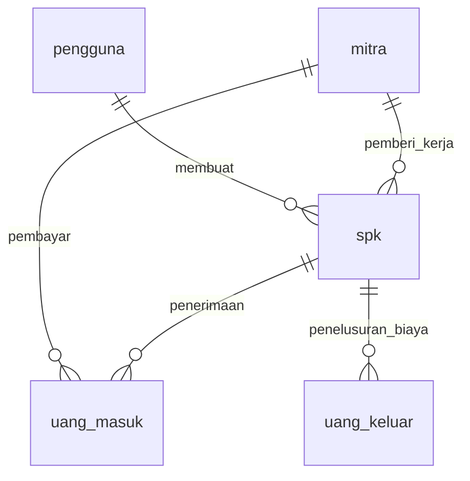

# Schema — Struktur Database (MySQL / MariaDB)
## Sistem Informasi SPK & Kontrol Keuangan — PT Barelang Kontraktor Sarana

> **5 TABEL** domain. Nama tabel & kolom memakai bahasa Indonesia.
> Status & kategori disimpan sebagai teks + divalidasi **PHP Enum** (lihat §7).

---

## 1. Keputusan yang Mengunci Schema Ini

| # | Keputusan | Dampak |
|---|---|---|
| 1 | **SPK adalah entitas inti. Tidak ada entitas PROYEK.** | Tidak ada tabel `proyek` |
| 2 | **Tidak ada Pengajuan Dana & Approval.** | Tidak ada tabel pengajuan |
| 3 | **`spk_id` dipertahankan di `uang_keluar`** (boleh NULL) | Penelusuran pengeluaran terkait pekerjaan; tidak digunakan menghitung laba-rugi |
| 4 | **Tidak ada approval Direktur.** | Tidak ada field `disetujui_oleh` / `tanggal_persetujuan` |
| 5 | **SPK subkon/vendor masuk tabel `spk`** | Tidak ada tabel `subcon_spk` |
| 6 | **Tidak ada tabel `bukti`.** Bukti jadi kolom `bukti` di `uang_masuk` & `uang_keluar` | Jumlah file **bebas** (JSON array) |
| 7 | **Ikuti skema awal — 5 tabel** | Status & kategori jadi kolom + **PHP Enum** |
| 8 | **Kolom `keterangan` di `spk` DIHAPUS** | Keputusan user — tidak perlu |
| 9 | **Audit log DIHAPUS** | Keputusan user — tidak perlu. Menyimpang dari SRS NFR-SEC-004 |
| 10 | **MySQL + full Laravel** | Migration, Eloquent, validasi di aplikasi |
| 11 | **Deployment lokal**, PC boleh dipakai kerja lain | Lihat `Architecture.md` §7 |

## 2. Ringkasan Tabel (5 Tabel)

| No | Tabel | Fungsi |
|---|---|---|
| 1 | `pengguna` | Akun pengguna sistem (Admin, Direktur) |
| 2 | `mitra` | Pihak terkait: PLN, pelanggan, vendor, subkon |
| 3 | `spk` | ⭐ Entitas inti — data SPK |
| 4 | `uang_masuk` | Uang masuk (dari SPK / luar SPK) |
| 5 | `uang_keluar` | Uang keluar (terkait SPK / umum) |

> **Tabel infrastruktur (bukan tabel domain ke-6):** `sessions`, `cache`, `jobs`,
> `failed_jobs`, `job_batches`, `exports`, `notifications`. Ini bawaan
> framework Laravel, bukan domain — tidak melanggar aturan "5 tabel" (`Rules.md` §1).
> `notifications` ditambahkan 11 Okt 2026 untuk notifikasi unduhan ekspor (B1-2).

## 3. Konvensi Umum

- Primary key: `BIGINT UNSIGNED` auto increment (konvensi Laravel).
- Foreign key: tipe **sama persis** dengan primary key yang dirujuk.
- Semua tabel operasional memiliki `created_at` dan `updated_at`.
- **Soft delete** (`deleted_at`) pada `spk`, `uang_masuk`, `uang_keluar`.
- **Nominal uang: `DECIMAL(18,2)`** — **DILARANG** `FLOAT`/`DOUBLE`.
- Unique constraint pada `spk.nomor_spk` dan `pengguna.email`.
- Index pada kolom yang sering difilter (status, tanggal, foreign key).
- **Nama tabel & kolom: bahasa Indonesia** (`Rules.md` §4).

## 4. DDL Lengkap

```sql
-- =========================================================
-- 1. pengguna
-- =========================================================
CREATE TABLE pengguna (
    id             BIGINT UNSIGNED PRIMARY KEY AUTO_INCREMENT,
    nama           VARCHAR(150) NOT NULL,
    email          VARCHAR(150) NOT NULL UNIQUE,
    password       VARCHAR(255) NOT NULL,
    peran          VARCHAR(50)  NOT NULL,        -- admin | direktur
    is_aktif       BOOLEAN DEFAULT TRUE,
    avatar         VARCHAR(255) NULL,            -- path disk privat 'nota' (foto profil)
    tanda_tangan   VARCHAR(255) NULL,            -- path disk privat 'nota' (ttd di PDF)
    terakhir_masuk TIMESTAMP NULL,               -- diisi otomatis saat login
    remember_token VARCHAR(100) NULL,
    created_at     TIMESTAMP NULL,
    updated_at     TIMESTAMP NULL
);
CREATE INDEX idx_pengguna_peran ON pengguna(peran);

-- =========================================================
-- 2. mitra
-- =========================================================
CREATE TABLE mitra (
    id         BIGINT UNSIGNED PRIMARY KEY AUTO_INCREMENT,
    nama       VARCHAR(200) NOT NULL,
    kategori   VARCHAR(50)  NOT NULL,   -- pln | pelanggan | vendor | subkon
    kontak     VARCHAR(100) NULL,
    alamat     VARCHAR(255) NULL,
    is_aktif   BOOLEAN DEFAULT TRUE,
    created_at TIMESTAMP NULL,
    updated_at TIMESTAMP NULL
);
CREATE INDEX idx_mitra_kategori ON mitra(kategori);

-- =========================================================
-- 3. spk  — ENTITAS INTI
-- =========================================================
CREATE TABLE spk (
    id             BIGINT UNSIGNED PRIMARY KEY AUTO_INCREMENT,
    nomor_spk      VARCHAR(150) NOT NULL UNIQUE,
    tanggal_spk    DATE NULL,                 -- NULL jika "TANPA SPK"
    tanggal_akhir  DATE NULL,                 -- revisi skema awal: tanggal akhir SPK
    nama_pekerjaan VARCHAR(255) NOT NULL,
    lokasi         VARCHAR(255) NULL,
    nilai_spk      DECIMAL(18,2) NOT NULL,

    -- Kolom retensi tidak digunakan; lihat migration penghapusannya di riwayat schema.

    jenis_sumber   VARCHAR(50) NULL,          -- pln | luar | internal | lainnya
    sheet_lama     VARCHAR(100) NULL,         -- referensi sheet Excel lama
    mitra_id       BIGINT UNSIGNED NULL,      -- pemberi kerja
    status_spk     VARCHAR(50) NULL,          -- draft|terbit|berjalan|selesai|sudah_ditagihkan|dibatalkan
    status_tagihan VARCHAR(50) NULL,          -- belum_ditagihkan|sudah_ditagihkan|revisi_dokumen|menunggu_pembayaran|dibayar
    dibuat_oleh    BIGINT UNSIGNED NOT NULL,
    created_at     TIMESTAMP NULL,
    updated_at     TIMESTAMP NULL,
    deleted_at     TIMESTAMP NULL,

    CONSTRAINT fk_spk_mitra   FOREIGN KEY (mitra_id)   REFERENCES mitra(id),
    CONSTRAINT fk_spk_pembuat FOREIGN KEY (dibuat_oleh) REFERENCES pengguna(id),
    CONSTRAINT chk_spk_nilai  CHECK (nilai_spk >= 0)
);
CREATE INDEX idx_spk_nomor     ON spk(nomor_spk);
CREATE INDEX idx_spk_status    ON spk(status_spk);
CREATE INDEX idx_spk_tagihan   ON spk(status_tagihan);
CREATE INDEX idx_spk_tanggal   ON spk(tanggal_spk);
CREATE INDEX idx_spk_pekerjaan ON spk(nama_pekerjaan);
CREATE INDEX idx_spk_mitra     ON spk(mitra_id);

-- =========================================================
-- 4. uang_masuk
-- =========================================================
CREATE TABLE uang_masuk (
    id             BIGINT UNSIGNED PRIMARY KEY AUTO_INCREMENT,
    spk_id         BIGINT UNSIGNED NULL,      -- NULL = uang masuk dari LUAR SPK
    nomor_spk      VARCHAR(150) NULL,         -- revisi skema awal
    nama_pekerjaan VARCHAR(255) NULL,         -- revisi skema awal
    tanggal        DATE NOT NULL,
    jumlah         DECIMAL(18,2) NOT NULL,
    mitra_id       BIGINT UNSIGNED NULL,
    keterangan     TEXT NULL,
    bukti          JSON NULL,                 -- 🆕 jumlah file BEBAS (TF, gambar, PDF)
    created_at     TIMESTAMP NULL,
    updated_at     TIMESTAMP NULL,
    deleted_at     TIMESTAMP NULL,

    CONSTRAINT fk_masuk_spk     FOREIGN KEY (spk_id)   REFERENCES spk(id),
    CONSTRAINT fk_masuk_mitra   FOREIGN KEY (mitra_id) REFERENCES mitra(id),
    CONSTRAINT chk_masuk_jumlah CHECK (jumlah > 0)
);
CREATE INDEX idx_masuk_spk     ON uang_masuk(spk_id);
CREATE INDEX idx_masuk_tanggal ON uang_masuk(tanggal);

-- =========================================================
-- 5. uang_keluar
-- =========================================================
CREATE TABLE uang_keluar (
    id         BIGINT UNSIGNED PRIMARY KEY AUTO_INCREMENT,
    spk_id     BIGINT UNSIGNED NULL,          -- ✅ dipertahankan (keputusan #3)
    tanggal    DATE NOT NULL,
    akun       VARCHAR(20) NULL DEFAULT 'kas', -- kas | bank (migrasi 26 Sep 2026)
    jumlah     DECIMAL(18,2) NOT NULL,
    kategori   VARCHAR(100) NULL,             -- material|upah|operasional|gaji|nota|transportasi|lainnya
    detail_kategori VARCHAR(150) NULL,        -- 🆕 wajib bila kategori = 'lainnya' (11 Okt 2026)
    penerima   VARCHAR(200) NULL,             -- nama vendor/subkon/staf
    keterangan TEXT NULL,
    bukti      JSON NULL,                     -- 🆕 jumlah file BEBAS (TF, gambar, PDF)
    created_at TIMESTAMP NULL,
    updated_at TIMESTAMP NULL,
    deleted_at TIMESTAMP NULL,

    CONSTRAINT fk_keluar_spk     FOREIGN KEY (spk_id) REFERENCES spk(id),
    CONSTRAINT chk_keluar_jumlah CHECK (jumlah > 0)
);
CREATE INDEX idx_keluar_spk      ON uang_keluar(spk_id);
CREATE INDEX idx_keluar_tanggal  ON uang_keluar(tanggal);
CREATE INDEX idx_keluar_kategori ON uang_keluar(kategori);
```

## 5. Perubahan dari Skema Awal (sesuai revisi & keputusan user)

### `spk`

| Field di skema awal | Status | Alasan |
|---|---|---|
| `pic` | ❌ **dihapus** | Revisi user: tidak digunakan |
| `keterangan` | ❌ **dihapus** | ✅ **Keputusan user: tidak perlu** |
| — | ✅ **ditambah** `tanggal_akhir` | Revisi user |

> 📌 **Catatan konsekuensi:** karena `keterangan` dihapus, catatan follow-up yang ada di setiap
> baris Excel (`27/7/2026 sudah diantar ke imperium`, `ada denda`, `PAKAI PT BKS`,
> `di potong 120.000 (uang material)`) **tidak punya tempat di sistem**.
> Jika nanti terasa perlu, kolom ini bisa ditambahkan kembali dengan satu migration.

### `uang_masuk`

| Field di skema awal | Status | Alasan |
|---|---|---|
| `nomor_transaksi` | ❌ dihapus | Revisi user |
| `sumber` | ❌ dihapus | Disimpulkan dari `spk_id` (ada = SPK, kosong = luar) |
| `metode_pembayaran` | ❌ dihapus | Revisi user |
| `status` | ❌ dihapus | Revisi user |
| `dicatat_oleh` | ❌ dihapus | Revisi user |
| — | ✅ **ditambah** `nama_pekerjaan`, `nomor_spk`, `bukti` | Revisi user |

**Form 2 mode (sesuai revisi user):**

| Mode | Field |
|---|---|
| **1. Berdasarkan SPK** | Dropdown list SPK + tanggal |
| **2. Manual** | Input `nama_pekerjaan` + `nomor_spk` bebas |

> 📌 `keterangan` **tetap ada** di `uang_masuk` (SRS: setiap transaksi perlu kolom keterangan).

### `uang_keluar`

| Field di skema awal | Status | Alasan |
|---|---|---|
| `nomor_transaksi` | ❌ dihapus | Revisi user |
| `mitra_id` | ❌ dihapus | Diganti `penerima` (teks) |
| `metode_pembayaran` | ❌ dihapus | Revisi user |
| `status` | ❌ dihapus | Revisi user |
| `dicatat_oleh` | ❌ dihapus | Revisi user |
| `disetujui_oleh` | ❌ **dihapus** | Keputusan #4 — tidak ada approval |
| `tanggal_persetujuan` | ❌ **dihapus** | Keputusan #4 — tidak ada approval |
| `spk_id` | ✅ **dipertahankan** | Menghubungkan transaksi dengan SPK untuk pelacakan penerimaan/pengeluaran |
| — | ✅ **ditambah** `bukti` | Revisi user |

### Tabel `bukti` — DIHAPUS

Bukti jadi kolom `bukti` bertipe **JSON** di `uang_masuk` & `uang_keluar`.
**Jumlah file bebas** — bisa 1, bisa 10, sesuai kebutuhan.

## 6. Nilai Turunan yang Dipakai Aplikasi

Nilai berikut dihitung dari transaksi dan tidak disimpan sebagai kolom ringkasan.

| Nilai | Rumus/keterangan |
|---|---|
| Total penerimaan | `SUM(uang_masuk.jumlah)` |
| Penerimaan dari SPK | `SUM(jumlah) WHERE spk_id IS NOT NULL` |
| Penerimaan luar SPK | `SUM(jumlah) WHERE spk_id IS NULL` |
| Total pengeluaran | `SUM(uang_keluar.jumlah)` |
| Pengeluaran per kategori | `SUM(jumlah) GROUP BY kategori` |
| Saldo kas/bank | Penerimaan dikurangi pengeluaran per nilai `akun`; dapat bernilai negatif |
| Nilai SPK | `SUM(spk.nilai_spk)` |
| Piutang per SPK | `max(0, nilai_spk − SUM(uang_masuk.jumlah untuk SPK tersebut))` |
| Tenggat | Selisih `tanggal_akhir` dengan tanggal hari ini; lewat atau mendekati dalam 14 hari |
| Jumlah SPK per status | `COUNT(*) GROUP BY status_spk` |

Tidak ada perhitungan retensi, laba-rugi, margin, atau umur piutang. `spk_id` pada
pengeluaran hanya menghubungkan catatan biaya dengan pekerjaan untuk penelusuran.
## 7. ⚠️ Risiko Desain 5 Tabel & Mitigasinya

Risiko ini **sudah dibuktikan** dengan uji di MariaDB 11.8 (dua skema, data identik).

### Bukti Risiko: Laporan Terpecah

| Tanggal | Kategori yang diketik | Jumlah |
|---|---|---|
| 01/07 | Material | 40.000.000 |
| 03/07 | Material Bangunan | 15.000.000 |
| 05/07 | Material2 *(typo)* | 5.000.000 |
| 12/07 | Upah | 25.000.000 |
| 14/07 | Upah Tukang | 10.000.000 |
| 20/07 | Operasional | 3.000.000 |

**Hasil pada skema kolom teks (5 tabel):**

| Kategori | Jml | Total |
|---|---|---|
| Material | 1 | 40.000.000 |
| Upah | 1 | 25.000.000 |
| Material Bangunan | 1 | 15.000.000 |
| Upah Tukang | 1 | 10.000.000 |
| Material2 | 1 | 5.000.000 |
| Operasional | 1 | 3.000.000 |

→ **6 baris.** Data "Material" terpecah 3, "Upah" terpecah 2. **Laporan salah.**

**Hasil pada skema master + FK (10 tabel):** 3 baris — Material 60 jt, Upah 35 jt. **Benar.**

### Daftar Risiko & Mitigasi

| # | Risiko | Berat | Mitigasi (full Laravel) |
|---|---|---|---|
| 1 | Laporan terpecah karena kategori ditulis berbeda | 🔴 Tinggi | **PHP Enum** + dropdown — Admin memilih, tidak mengetik |
| 2 | Typo status SPK → filter & laporan salah | 🔴 Tinggi | **PHP Enum** + `Rule::enum()` |
| 3 | Tambah status baru perlu `ALTER TABLE` | 🟡 Sedang | Terima, atau tambah nilai Enum + migration |
| 4 | Tidak ada proteksi di level database | 🟡 Sedang | **Form Request** + validasi enum |
| 5 | ~~Audit log tidak ada~~ | — | ✅ **Keputusan user: tidak perlu** |
| 6 | Storage sedikit lebih besar | 🟢 Rendah | Tidak perlu ditangani |

### Solusi Utama: PHP Enum (bawaan Laravel)

```php
<?php
declare(strict_types=1);

namespace App\Enums;

enum StatusSpk: string
{
    case Draft           = 'draft';
    case Terbit          = 'terbit';
    case Berjalan        = 'berjalan';
    case Selesai         = 'selesai';
    case SudahDitagihkan = 'sudah_ditagihkan';
    case Dibatalkan      = 'dibatalkan';

    public function label(): string
    {
        return match ($this) {
            self::Draft           => 'Draft',
            self::Terbit          => 'Terbit',
            self::Berjalan        => 'Berjalan',
            self::Selesai         => 'Selesai',
            self::SudahDitagihkan => 'Sudah Ditagihkan',
            self::Dibatalkan      => 'Dibatalkan',
        };
    }
}
```

**Model Eloquent:**

```php
protected function casts(): array
{
    return [
        'status_spk' => StatusSpk::class,
        'bukti'      => 'array',      // JSON array, jumlah file bebas
    ];
}
```

**Form Request (validasi):**

```php
'status_spk' => ['required', Rule::enum(StatusSpk::class)],
'kategori'   => ['required', Rule::enum(KategoriPengeluaran::class)],
'bukti'      => ['nullable', 'array'],
'bukti.*'    => ['file', 'mimes:jpg,jpeg,png,pdf', 'max:10240'],
```

**Form Blade (dropdown dari enum):**

```blade
<select name="status_spk">
    @foreach (App\Enums\StatusSpk::cases() as $s)
        <option value="{{ $s->value }}">{{ $s->label() }}</option>
    @endforeach
</select>
```

**Hasil:** Admin **tidak bisa** mengetik bebas → typo mustahil → laporan tetap konsisten,
**tanpa tabel master**. Menutup risiko #1, #2, dan #4.

## 8. ⚠️ Konsekuensi Audit Log Dihapus

Keputusan user: **audit log tidak perlu.** Konsekuensinya:

| Dampak | Penjelasan |
|---|---|
| **Menyimpang dari SRS NFR-SEC-004** | SRS mewajibkan *"setiap perubahan nominal & upload dokumen harus tercatat"* |
| Tidak ada jejak siapa mengubah nominal | Kalau ada selisih angka, sulit ditelusuri |
| Tidak ada rekam jejak penghapusan | Soft delete tetap ada, tapi tidak ada catatan siapa & kapan |
| Dokumen SRS perlu disesuaikan | Bagian NFR-SEC-004 harus diubah agar konsisten |

**Jika nanti diperlukan**, ada 2 cara menambah tanpa mengubah schema banyak:
1. **Package `spatie/laravel-activitylog`** — otomatis membuat tabelnya sendiri
2. Tambah tabel `log_aktivitas` — jadi 6 tabel

## 9. Dokumen SPK dan Bukti Transaksi

Dokumen SPK disimpan pada `spk.dokumen`; bukti transaksi pada `uang_masuk.bukti`
dan `uang_keluar.bukti`. Seluruh berkas disimpan di disk privat dan diakses
melalui route terautentikasi. Jenis dan batas file mengikuti validasi form.

## 10. Rencana Migrasi Data dari Excel

| Sumber | Target | Aturan |
|---|---|---|
| Daftar SPK | `spk` | Bersihkan dan deduplikasi sebelum import |
| Penerimaan SPK | `uang_masuk` | `spk_id` diisi |
| Penerimaan luar SPK | `uang_masuk` | `spk_id` NULL |
| Pengeluaran terkait SPK | `uang_keluar` | `spk_id` diisi |
| Pengeluaran umum | `uang_keluar` | `spk_id` NULL |

## 11. Output Laporan dan Ekspor

| Bagian | Data | Kolom pokok ekspor |
|---|---|---|
| Arus kas bulanan | `uang_masuk` + `uang_keluar` | Bulan, jumlah transaksi masuk, total masuk, total keluar, selisih |
| Pengeluaran per kategori | `uang_keluar` | Kategori, jumlah transaksi, total |
| Daftar SPK | `spk` + `uang_masuk` | Nomor SPK, pekerjaan, nilai, diterima, belum diterima, status SPK, status tagihan |
| Piutang | `spk` + `uang_masuk` | SPK, mitra, nilai, diterima, belum diterima, status tagihan, tenggat |
| Tenggat | `spk` | SPK, pekerjaan, mitra, tanggal tenggat, sisa hari, nilai |
| Buku kas/bank | `uang_masuk` + `uang_keluar` | Tanggal, referensi, keterangan, debet, kredit, saldo berjalan |

Format tersedia CSV, XLSX, dan PDF pada bagian yang relevan. Piutang memakai
penerimaan terkait SPK; uang masuk luar SPK tidak menguranginya. Angka transaksi
mengikuti periode yang dipilih; nilai SPK/piutang dan saldo merupakan posisi saat ini.

## 12. Relasi (ERD Tekstual)

Struktur relasi mengikuti lima tabel domain dan foreign key pada migration.



## 13. Aturan Integritas

1. `jumlah` harus lebih dari nol; `nilai_spk` tidak boleh negatif.
2. Arah transaksi ditentukan tabelnya, bukan tanda minus.
3. `uang_masuk.spk_id` terisi untuk penerimaan SPK dan NULL untuk penerimaan luar SPK.
4. `uang_keluar.spk_id` boleh NULL untuk pengeluaran umum.
5. Status, kategori, dan peran divalidasi dengan PHP Enum.
6. Histori transaksi memakai soft delete, bukan penghapusan fisik.
7. Perubahan multi-tabel dilakukan dalam transaksi database.

---

## 14. Ringkasan Perubahan v3.1

Dokumen ini menjelaskan schema aplikasi saat ini. Migration adalah sumber kebenaran
untuk struktur database yang sedang terpasang.
